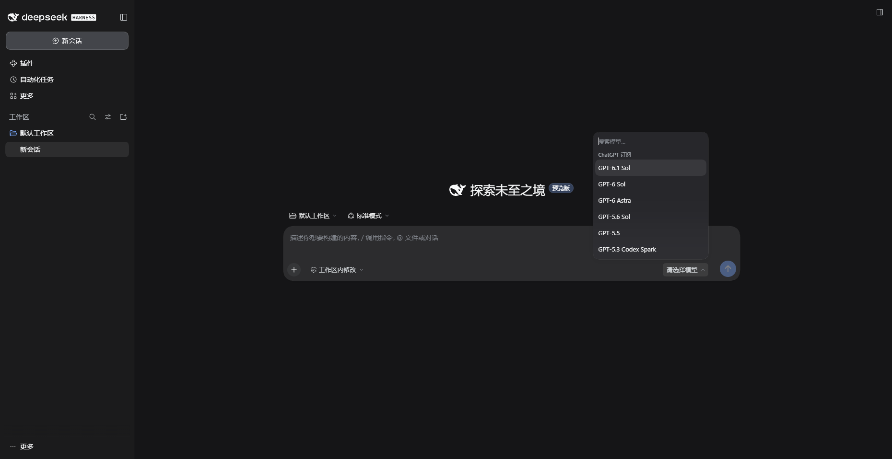
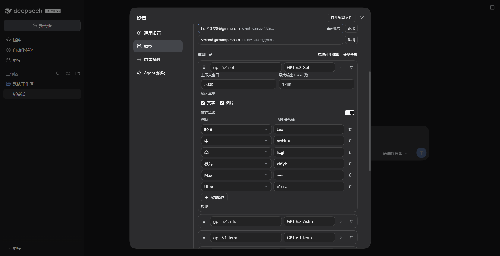

# 第三方订阅渠道 · dsh-subscription-channels

> 用你已有的 **ChatGPT / Google Antigravity / Claude 订阅账号**里的模型，直接在 [DeepSeek Harness](https://github.com/deepseek-ai/deepseek-harness)（DSH）里对话 —— 不需要另外购买 API Key。

这是 DSH 的一个插件（bundle）。它在 **设置 → 模型** 页面新增一个 **第三方订阅渠道** 入口：登录你已有的订阅账号，账号内附带的模型会立刻以独立提供商出现在输入框的模型选择器里；退出登录后立即消失。






## 功能

- **一个入口**：紧跟官方「添加模型提供商」之后，与「第三方模型提供商」「自定义模型 API」并列，不替换官方界面。
- **三种渠道**：ChatGPT 订阅（官方 Sign in with ChatGPT）、Claude 订阅（Pro / Max）、Google Antigravity。
- **浏览器登录**：OAuth + PKCE；本机回环回调自动完成，回调端口被占用或无法回调时，可以在卡片里粘贴授权码 / 回调地址。
- **凭据安全**：令牌只写入 DSH 凭据库（记录键 `dsh-subscription-channels/<渠道>`），不写入配置文件、不打印到日志、不返回给浏览器；面板只显示账号邮箱与到期时间。
- **自动续期**：访问令牌快过期时用刷新令牌换取新令牌；上游返回 401 时撤销对应模型并清掉失效记录。
- **模型目录**：每个渠道内可查看/删除/恢复模型，删除后不再出现在输入框的模型选择器；「获取可用模型」把账号侧可用模型重新并入目录。
- **逐模型检测**：勾选模型即可发起一次最小真实请求，返回「可用 + 延迟」或失败原因（授权失效、额度用尽、限流、模型不可用、上游异常、超时、网络错误）。
- **逐模型自定义**：上下文窗口、最大输出 token 数、推理等级、输入类型（文本/图片）都可单独覆盖，交互与 DSH 自带「自定义模型 API」面板一致。
- **可覆盖参数**：OAuth 客户端参数、Cloud Code 主机、无头环境等都可以在插件配置里改。

## 安装

要求：DeepSeek Harness **0.2.2-rc.3** 及以上的 desktop / web profile。

### 方式一：插件管理器（推荐）

1. 打开 **设置 → 插件 → 添加插件**。
2. 在「包名或地址」填入本仓库地址：

   ```text
   github:OMEN111111/dsh-subscription-llm
   ```

3. 点「安装」，然后到 **设置 → 模型** 使用。

### 方式二：命令行

```bash
dsh plugin --profile <你的 profile 名> add github:OMEN111111/dsh-subscription-llm
```

随后在 DSH 的 **设置 → 插件** 里启用这个 bundle（CLI 只安装依赖；`dsh.profile.bundles` 的选择由插件管理器完成）。

### 方式三：本地目录

把仓库克隆到任意目录，在 **设置 → 插件 → 添加插件** 里填该目录的绝对路径；这种方式会以链接方式安装，改动代码后刷新页面即生效。

## 使用

1. 打开 **设置 → 模型**，点「添加模型提供商」下方的 **第三方订阅渠道**。
2. 在需要的渠道上点 **登录**：
   - ChatGPT：浏览器打开 `auth.openai.com` 授权页；授权后会自动回到本机 1455 端口。
   - Claude：浏览器打开 `claude.ai` 授权页；回环 53692 端口，或按提示粘贴 `code#state`。
   - Google Antigravity：浏览器打开 Google 授权页；回环 51121 端口。若端口被 Antigravity 客户端占用，先退出它。
3. 授权成功后行内显示 **已登录 · 账号邮箱**，模型立刻可选。
4. 不再使用时点 **退出登录**（需要再点一次「确认退出」）。

### 模型目录与检测

登录后点渠道卡片上的 **编辑** 打开 **模型目录**（与 DSH 自带「自定义模型 API」面板同构）：

- 每行：拖动排序、模型 ID、显示名称、展开、删除。删除会立即把该行从编辑器里移除，同时不再出现在模型选择器。
- **获取可用模型** 弹出可用模型列表（默认勾选当前被移除的模型），确认后把勾选项加回目录；**恢复默认模型** 清掉全部改动。
- 展开一行的 **模型选项**：上下文窗口、最大输出 token 数（均支持 `131072` / `256K` / `1M`）、输入类型（文本 / 图片）、推理等级。
- 推理等级按模型实际支持列出（例如 `gpt-6.1-sol` 为 轻度 / 中 / 高 / 极高 / Ultra），每行都是「档位 + API 参数值」两列，**API 参数值可直接编辑**，也可以增删档位。
- `+ 添加模型` 可以手动加入账号目录里没有的模型 ID。
- **检测**：行内 `检测` 或头部 `检测全部` 发起一次最小真实请求，显示 `可用 · 320ms` 或 `不可用 · 原因`（授权失效、额度用尽、限流、模型不存在、上游异常、超时、网络错误）。
- 目录与改动保存在 `<DSH_HOME>/subscription-channels/catalog.json`；删除只影响选择器，已有会话仍可继续。

## 支持的渠道

| 渠道 | DSH 提供商 id | 登录 | 上游接口 | 内置模型（v0.2.0） |
| --- | --- | --- | --- | --- |
| ChatGPT 订阅 | `chatgpt-sub` | 官方 Sign in with ChatGPT（动态注册 + PKCE，回环 127.0.0.1:1455 / 粘贴） | `https://api.openai.com/v1/responses`（`store:false` / `stream:true`） | 账号内 `/v1/models` 返回的模型；静态表仅作离线兜底 |
| Claude 订阅 | `claude-sub` | OAuth（PKCE，回环 53692 / 粘贴 `code#state`） | Anthropic Messages | Claude Opus 5.5 / Sonnet 5.5 / Opus 5 / Sonnet 5 / Opus 4.8 / Sonnet 4.6 / Haiku 4.5 |
| Google Antigravity | `google-antigravity` | Google OAuth（PKCE，回环 51121 / 粘贴） | Cloud Code Assist `v1internal:streamGenerateContent` | Gemini 4 Argon、Gemini 3.8 Flash（low/medium/high）、Gemini 3 Pro、Claude Opus/Sonnet 5.5、GPT-OSS 120B；账号登录后会尝试用 `fetchAvailableModels` 覆盖为账号真实可用的目录 |

模型目录与账号等级相关，登录后以账号实际返回为准。

## 配置

写在 bundle patch 里该行的 `config` 下（全部可选，均有默认值）：

```yaml
- id: subscription-channels
  name: 'dsh-subscription-channels'
  config:
    lang: zh                       # 提供商显示名与提示语言：zh / en
    siwcAgentName: DeepSeek Harness # 官方授权页展示的应用名
    openBrowser: true              # 无头环境设为 false，改为手动打开卡片里的链接
    antigravityHost: https://daily-cloudcode-pa.googleapis.com
    googleClientId: <override>     # Google 轮换 OAuth 客户端时覆盖
    googleClientSecret: <必填>      # Antigravity 登录所需的 OAuth 客户端密钥，见下节
    loginTimeoutMs: 600000
```

### Antigravity 的客户端密钥

Google Antigravity 的登录使用 Antigravity 客户端自己的 OAuth 客户端，其 **client secret 不由本仓库分发**（它是该客户端的 installed-app 密钥，且仓库的密钥扫描会拒绝发布）。使用 Antigravity 渠道前，任选一种方式提供：

```bash
# 方式一：环境变量（对 DSH 进程生效）
setx DSH_ANTIGRAVITY_CLIENT_SECRET "<the antigravity client secret>"
```

```js
// 方式零（仅本机）：仓库已 gitignore 的 src/antigravity-secret.local.js
export const CLIENT_SECRET = '<the antigravity client secret>'
```

```yaml
# 方式二：插件配置
- id: subscription-channels
  name: 'dsh-subscription-channels'
  config:
    googleClientSecret: '<the antigravity client secret>'
```

同一个值在任何公开的 Antigravity 逆向实现里都能找到，例如社区项目 [`NoeFabris/opencode-antigravity-auth`](https://github.com/NoeFabris/opencode-antigravity-auth) 的 `src/constants.ts`。缺少该值时，卡片会在打开浏览器前直接给出提示，不会发起无效授权。ChatGPT 与 Claude 渠道无需任何额外配置。

## 工作原理

- **Host 半**（[index.js](index.js)、[src/](src)）：注册三条 `ctx.authorization` 登录流程；用 `ctx.credentials` 存取授权；按渠道注册 LLM adapter（[src/adapter.js](src/adapter.js)），实现 `providerInfo / listModels / resolveModel / stream`；把请求翻译成各家线路协议（[src/channels/](src/channels)）。
- **浏览器半**（[client.js](client.js)）：注册到官方槽位 `settings.models.footer`，用插件自己的 `/api/dsh-subscription-channels/*` 精确路由与 Host 通信；这些路由只对 owner principal 开放，浏览器拿不到令牌。
- **状态同步**：凭据库激活、记录变化、登录/退出都会重新同步路由注册，因此外部写入的登录态也能被识别。

## 测试

仓库带有 51 项单元/集成测试，覆盖三条线路的流解析与请求体构造、图片序列化、令牌轮换、路由同步、超时结算、目录覆盖与可见性、检测结果分类：

```bash
npm test        # 等价于 node --test test/wire.test.mjs test/service.test.mjs
```

开发时另外在**隔离的 DSH 环境**（独立 `DSH_HOME`、`web` 模板 profile、独立端口）里验证过：插件启动、`/api/.../state`、错误分支、设置页卡片、登录面板、取消与退出登录、模型选择器出现「ChatGPT 订阅」分组。真实账号的 OAuth 授权与真实模型调用需要账号本人在浏览器完成，未包含在自动化验证里。

## 已知限制与风险

- ChatGPT 渠道使用官方文档化的 Sign in with ChatGPT 与公开 Responses 接口；Claude 与 Antigravity 渠道仍在调用各自客户端使用的非公开接口（Claude Code 的 OAuth 客户端、Antigravity 的 Cloud Code Assist）。后者可能随时调整，届时需要更新本插件或通过配置覆盖参数；这也是它们不符合各家公开发布规范的地方，请自行评估账号风险。
- Claude 与 Antigravity 渠道要求携带对应客户端的标识头（`user-agent: claude-cli/…`、Antigravity Hub UA），请求因此会声明为对应客户端。
- 图片输入仅在把某模型的**输入类型**勾选「图片」后转发（ChatGPT / Claude / Antigravity 各自使用官方的图片块）；文件附件仍不转发。
- 令牌与账号信息保存在本机 DSH 凭据库中；插件不向任何第三方服务器上报数据，唯一的出站请求是各渠道自己的 OAuth / 模型接口。

## 版本

- **v0.2.9**：图片输入打通（模型按 /v1/models 的 input_modalities 声明，未声明时静态表兜底；已用真实账号发送 PNG 验证）；模型目录同时带入 context_window、推理档位与默认档位。
- **v0.2.8**：账号列表自动命名（邮箱前缀）并显示 client=… 前缀；支持逐个退出账号（两步确认），退出当前账号后自动切到仍可用的账号。
- **v0.2.7**：移除旧 Codex 接入路径（遗留 grant 视为未登录）；设置页新增 ChatGPT 账号列表，可切换当前账号。
- **v0.2.6**：真实账号回归（工具调用 + 第二轮历史、额度/断流错误映射、并发刷新）。
- **v0.2.5**：ChatGPT 渠道行显示当前账号，并提供「添加账号」（走新注册，不覆盖已保存账号）；账号切换界面留待后续版本。
- **v0.2.4**：同一注册的并发请求共享一次令牌刷新（单飞），避免轮换令牌互相作废；跨进程并发仍以最后写入为准。
- **v0.2.3**：凭据记录改为「按签发 client_id 隔离的注册集合 + 当前账号」，旧单条记录自动升级；登出保留注册关系与主机 ID，其他账号不受影响。
- **v0.2.2**：ChatGPT 渠道改用官方 **Sign in with ChatGPT**（动态注册、ID Token 验签、计划权限校验、/v1/responses 契约、刷新轮换与撤销）；模型目录改由 /v1/models 提供。
- **v0.2.1**：渠道目录收进「编辑」；获取可用模型 改为弹窗选择；删除即时生效；推理档位按模型真实支持并支持自定义 API 参数值；修复 Windows 打开登录页时 URL 被 & 截断导致 missing_required_parameter / 缺少 client_id；去掉与退出登录重复的「重新登录」。
- **v0.2.0**：新增模型目录（删除 / 恢复 / 排序 / 添加模型 / 获取可用模型）、逐模型检测与失败原因、逐模型自定义（上下文窗口、最大输出、推理等级、输入类型），并支持图片输入；界面与 DSH 自带模型编辑面板一致。
- **v0.1.0**：首个版本。三个渠道的登录、模型注册、退出登录、错误处理与中英文文案。

## 许可证

[MIT](LICENSE)

---

**English**: A DeepSeek Harness plugin that adds a *subscription channels* entry to Settings → Models, letting you sign in to existing ChatGPT, Google Antigravity, or Claude subscriptions (OAuth + PKCE, credentials in the local DSH store) and use their models directly. Unofficial upstream endpoints; text and tool calls only; MIT licensed.


