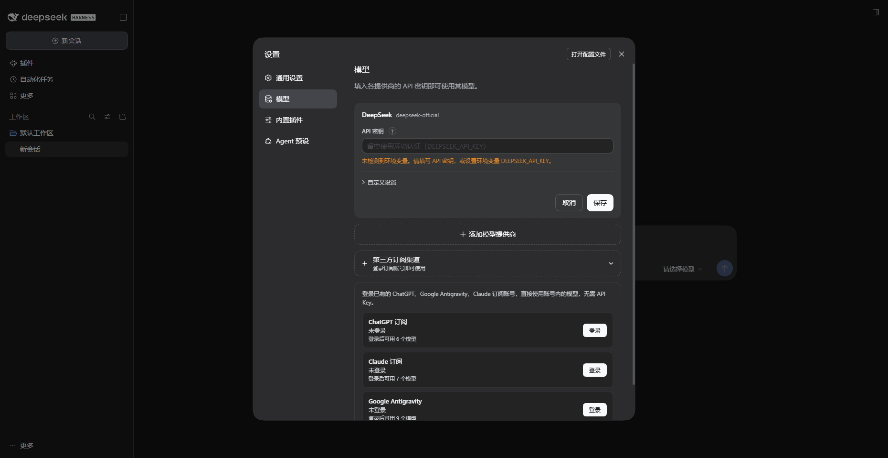

# 第三方订阅渠道 · dsh-subscription-channels

> 用你已有的 **ChatGPT / Google Antigravity / Claude 订阅账号**里的模型，直接在 [DeepSeek Harness](https://github.com/deepseek-ai/deepseek-harness)（DSH）里对话 —— 不需要另外购买 API Key。

这是 DSH 的一个插件（bundle）。它在 **设置 → 模型** 页面新增一个 **第三方订阅渠道** 入口：登录你已有的订阅账号，账号内附带的模型会立刻以独立提供商出现在输入框的模型选择器里；退出登录后立即消失。




## 功能

- **一个入口**：紧跟官方「添加模型提供商」之后，与「第三方模型提供商」「自定义模型 API」并列，不替换官方界面。
- **三种渠道**：ChatGPT 订阅（Codex）、Claude 订阅（Pro / Max）、Google Antigravity。
- **浏览器登录**：OAuth + PKCE；本机回环回调自动完成，回调端口被占用或无法回调时，可以在卡片里粘贴授权码 / 回调地址。
- **凭据安全**：令牌只写入 DSH 凭据库（记录键 `dsh-subscription-channels/<渠道>`），不写入配置文件、不打印到日志、不返回给浏览器；面板只显示账号邮箱与到期时间。
- **自动续期**：访问令牌快过期时用刷新令牌换取新令牌；上游返回 401 时撤销对应模型并清掉失效记录。
- **模型目录**：每个渠道内可查看/删除/恢复模型，删除后不再出现在输入框的模型选择器；「获取可用模型」把账号侧可用模型重新并入目录。
- **逐模型检测**：勾选模型即可发起一次最小真实请求，返回「可用 + 延迟」或失败原因（授权失效、额度用尽、限流、模型不可用、上游异常、超时、网络错误）。
- **逐模型自定义**：上下文窗口、最大输出 token 数、推理等级、输入类型（文本/图片）都可单独覆盖，交互与 DSH 自带「自定义模型 API」面板一致。
- **可覆盖参数**：OAuth 客户端参数、Cloud Code 主机、`originator`、无头环境等都可以在插件配置里改。

## 安装

要求：DeepSeek Harness **0.2.2-rc.3** 及以上的 desktop / web profile。

### 方式一：插件管理器（推荐）

1. 打开 **设置 → 插件 → 添加插件**。
2. 在「包名或地址」填入本仓库地址：

   ```text
   github:OMEN111111/dsh-subscription-llm
   ```

3. 点「安装」，然后到 **设置 → 模型** 使用。

### 方式二：命令行

```bash
dsh plugin --profile <你的 profile 名> add github:OMEN111111/dsh-subscription-llm
```

随后在 DSH 的 **设置 → 插件** 里启用这个 bundle（CLI 只安装依赖；`dsh.profile.bundles` 的选择由插件管理器完成）。

### 方式三：本地目录

把仓库克隆到任意目录，在 **设置 → 插件 → 添加插件** 里填该目录的绝对路径；这种方式会以链接方式安装，改动代码后刷新页面即生效。

## 使用

1. 打开 **设置 → 模型**，点「添加模型提供商」下方的 **第三方订阅渠道**。
2. 在需要的渠道上点 **登录**：
   - ChatGPT：浏览器打开 `auth.openai.com` 授权页；授权后会自动回到本机 1455 端口。
   - Claude：浏览器打开 `claude.ai` 授权页；回环 53692 端口，或按提示粘贴 `code#state`。
   - Google Antigravity：浏览器打开 Google 授权页；回环 51121 端口。若端口被 Antigravity 客户端占用，先退出它。
3. 授权成功后行内显示 **已登录 · 账号邮箱**，模型立刻可选。
4. 不再使用时点 **退出登录**（需要再点一次「确认退出」）。

### 模型目录与检测

登录后点渠道行上的 **模型目录**：

- 行内勾选框用于批量检测，底部 **检测选中（n）** 依次发起最小真实请求，每行显示结果：`可用 · 320ms`，或 `不可用：原因`（悬停可看上游原文）。
- 右侧 **删除** 会把模型移出选择器；被删除的行变暗并显示 **恢复**。
- 头部 **获取可用模型** 向账号询问当前可用模型并并入目录（Antigravity 走 `fetchAvailableModels`，ChatGPT / Claude 使用插件内置目录）；**全部恢复** 一次恢复所有已删除模型。
- 展开 **模型选项** 可改：上下文窗口（支持 `131072` / `256K` / `1M`）、最大输出 token 数、输入类型（文本 / 图片，至少保留一项）、推理等级（该模型支持的档位与默认档）。
- 目录与改动保存在 `<DSH_HOME>/subscription-channels/catalog.json`，重启后仍在；删除只是「不在选择器里显示」，已有会话仍可继续。

## 支持的渠道

| 渠道 | DSH 提供商 id | 登录 | 上游接口 | 内置模型（v0.2.0） |
| --- | --- | --- | --- | --- |
| ChatGPT 订阅 | `chatgpt-sub` | OAuth（PKCE，回环 1455 / 粘贴） | ChatGPT 后端 Codex Responses | GPT-6.1 Sol、GPT-6 Sol、GPT-6 Astra、GPT-5.6 Sol、GPT-5.5、GPT-5.3 Codex Spark |
| Claude 订阅 | `claude-sub` | OAuth（PKCE，回环 53692 / 粘贴 `code#state`） | Anthropic Messages | Claude Opus 5.5 / Sonnet 5.5 / Opus 5 / Sonnet 5 / Opus 4.8 / Sonnet 4.6 / Haiku 4.5 |
| Google Antigravity | `google-antigravity` | Google OAuth（PKCE，回环 51121 / 粘贴） | Cloud Code Assist `v1internal:streamGenerateContent` | Gemini 4 Argon、Gemini 3.8 Flash（low/medium/high）、Gemini 3 Pro、Claude Opus/Sonnet 5.5、GPT-OSS 120B；账号登录后会尝试用 `fetchAvailableModels` 覆盖为账号真实可用的目录 |

模型目录与账号等级相关，登录后以账号实际返回为准。

## 配置

写在 bundle patch 里该行的 `config` 下（全部可选，均有默认值）：

```yaml
- id: subscription-channels
  name: 'dsh-subscription-channels'
  config:
    lang: zh                       # 提供商显示名与提示语言：zh / en
    openBrowser: true              # 无头环境设为 false，改为手动打开卡片里的链接
    originator: codex_cli_rs       # 发给 ChatGPT 后端的 originator
    antigravityHost: https://daily-cloudcode-pa.googleapis.com
    googleClientId: <override>     # Google 轮换 OAuth 客户端时覆盖
    googleClientSecret: <必填>      # Antigravity 登录所需的 OAuth 客户端密钥，见下节
    loginTimeoutMs: 600000
```

### Antigravity 的客户端密钥

Google Antigravity 的登录使用 Antigravity 客户端自己的 OAuth 客户端，其 **client secret 不由本仓库分发**（它是该客户端的 installed-app 密钥，且仓库的密钥扫描会拒绝发布）。使用 Antigravity 渠道前，任选一种方式提供：

```bash
# 方式一：环境变量（对 DSH 进程生效）
setx DSH_ANTIGRAVITY_CLIENT_SECRET "<the antigravity client secret>"
```

```yaml
# 方式二：插件配置
- id: subscription-channels
  name: 'dsh-subscription-channels'
  config:
    googleClientSecret: '<the antigravity client secret>'
```

同一个值在任何公开的 Antigravity 逆向实现里都能找到，例如社区项目 [`NoeFabris/opencode-antigravity-auth`](https://github.com/NoeFabris/opencode-antigravity-auth) 的 `src/constants.ts`。缺少该值时，卡片会在打开浏览器前直接给出提示，不会发起无效授权。ChatGPT 与 Claude 渠道无需任何额外配置。

## 工作原理

- **Host 半**（[index.js](index.js)、[src/](src)）：注册三条 `ctx.authorization` 登录流程；用 `ctx.credentials` 存取授权；按渠道注册 LLM adapter（[src/adapter.js](src/adapter.js)），实现 `providerInfo / listModels / resolveModel / stream`；把请求翻译成各家线路协议（[src/channels/](src/channels)）。
- **浏览器半**（[client.js](client.js)）：注册到官方槽位 `settings.models.footer`，用插件自己的 `/api/dsh-subscription-channels/*` 精确路由与 Host 通信；这些路由只对 owner principal 开放，浏览器拿不到令牌。
- **状态同步**：凭据库激活、记录变化、登录/退出都会重新同步路由注册，因此外部写入的登录态也能被识别。

## 测试

仓库带有 26 项单元/集成测试，覆盖三条线路的流解析与请求体构造、图片序列化、令牌轮换、路由同步、超时结算、目录覆盖与可见性、检测结果分类：

```bash
npm test        # 等价于 node --test test/wire.test.mjs test/service.test.mjs
```

开发时另外在**隔离的 DSH 环境**（独立 `DSH_HOME`、`web` 模板 profile、独立端口）里验证过：插件启动、`/api/.../state`、错误分支、设置页卡片、登录面板、取消与退出登录、模型选择器出现「ChatGPT 订阅」分组。真实账号的 OAuth 授权与真实模型调用需要账号本人在浏览器完成，未包含在自动化验证里。

## 已知限制与风险

- 三个渠道使用的都是各订阅产品**自身客户端**所用的非公开接口（Codex Responses、Claude Code 的 OAuth 客户端、Antigravity 的 Cloud Code Assist）。这些接口可能随时调整，届时需要更新本插件或通过配置覆盖参数；这也是它们不符合各家公开发布规范的地方，请自行评估账号风险。
- 上游要求携带对应客户端的标识头（`originator`、`user-agent: claude-cli/…`、Antigravity Hub UA），请求因此会声明为对应客户端。
- 图片输入仅在把某模型的**输入类型**勾选「图片」后转发（ChatGPT / Claude / Antigravity 各自使用官方的图片块）；文件附件仍不转发。
- 令牌与账号信息保存在本机 DSH 凭据库中；插件不向任何第三方服务器上报数据，唯一的出站请求是各渠道自己的 OAuth / 模型接口。

## 版本

- **v0.2.0**：新增模型目录（删除 / 恢复 / 获取可用模型）、逐模型检测与失败原因、逐模型自定义（上下文窗口、最大输出、推理等级、输入类型），并支持图片输入。
- **v0.1.0**：首个版本。三个渠道的登录、模型注册、退出登录、错误处理与中英文文案。

## 许可证

[MIT](LICENSE)

---

**English**: A DeepSeek Harness plugin that adds a *subscription channels* entry to Settings → Models, letting you sign in to existing ChatGPT, Google Antigravity, or Claude subscriptions (OAuth + PKCE, credentials in the local DSH store) and use their models directly. Unofficial upstream endpoints; text and tool calls only; MIT licensed.


